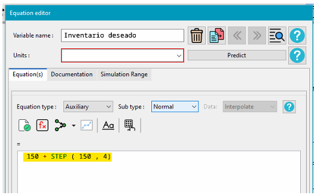
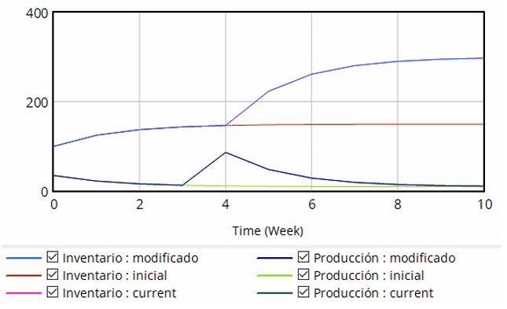

## 1. Planteo del Problema
En la gestión de operaciones, un desafío frecuente es determinar el volumen óptimo de producción. Si se fabrica una cantidad fija sin considerar el nivel real de existencias, se corre el riesgo de acumular mercadería en exceso, lo que genera altos costos de refrigeración, inmovilización de capital y riesgo de vencimiento del producto.

Para el caso de la cámara de frío de una cervecería artesanal, proponemos implementar un "sistema autorregulado". En lugar de mantener una tasa de envasado rígida y desvinculada de la realidad, la planta evaluará continuamente la diferencia entre los barriles físicos almacenados y una meta ideal de seguridad. En base a esta brecha, el ritmo de embarrilado se ajustará dinámicamente para mantener el equilibrio, garantizando el abastecimiento a los bares sin caer en el sobrealmacenamiento.

Adicionalmente, se plantea la necesidad de evaluar la robustez y capacidad de respuesta de este sistema ante escenarios de shock operativo. Para ello, se someterá el modelo a una perturbación controlada (función escalón - "STEP"), simulando un requerimiento abrupto por parte de la gerencia comercial para duplicar la meta de stock de seguridad de cara a un festival cervecero, con el objetivo de analizar la respuesta transitoria de la planta.

## 2. Uso de Vensim PLE
Para validar el funcionamiento de esta política de control y su respuesta ante perturbaciones, utilizamos Vensim PLE, un software especializado en dinámica de sistemas. Esta herramienta permite modelar gráficamente la estructura del problema mediante un diagrama de Forrester y simular el paso del tiempo. De este modo, es posible proyectar matemáticamente el comportamiento del stock de barriles y del ritmo de producción sin necesidad de alterar las operaciones en la planta real.

## 3. Parámetros Utilizados y Diseño del Modelo
Para estructurar la simulación, se definieron las siguientes variables operativas base:

- **Horizonte temporal:** El análisis se proyectó para un período de 10 semanas.
- **Inventario (Stock):** Representa la cámara de frío. Inicia con 100 barriles en stock.
- **Ventas (Salida):** Representa el despacho a los bares, fijado en una salida constante de 10 barriles semanales.
- **Tiempo de Ajuste:** Es el período de respuesta de la planta, estimado en 2 semanas, para corregir cualquier déficit de inventario (tiempo necesario para cocinar, fermentar y envasar nuevos lotes).
- **Producción (Entrada):** Es la variable dinámica que calcula cuántos barriles llenar semanalmente para cubrir las ventas y alcanzar la meta de stock.

### Escenarios de Prueba
Para un análisis exhaustivo, el modelo se ejecutó bajo dos escenarios de simulación:

**1. Escenario Inicial (Estabilidad):**

- La variable de control Inventario Deseado (meta de stock) se fijó como una constante estática de 150 barriles durante todo el horizonte temporal.

**2. Escenario Modificado (Perturbación mediante Función STEP):**

- Se reemplazó la constante estática por una función matemática que introduce un cambio abrupto: `$150 + STEP(150, 4)$`.

- ¿Qué representa la función STEP? Simula un escenario donde el Inventario Deseado comienza en 150 barriles, pero exactamente en la semana 4, la gerencia exige un incremento súbito de 150 barriles adicionales (elevando la meta a 300 barriles). Esto permite estudiar la "frecuencia natural" o velocidad de reacción del sistema.

## 4. Análisis de Resultados de la Simulación
Al ejecutar la simulación comparativa de ambos escenarios (inicial y modificado), se obtuvieron cuatro curvas de comportamiento superpuestas en el mismo gráfico temporal.

### Análisis del Escenario Inicial (Estabilidad)
Las curvas roja (Inventario: inicial) y verde claro (Producción: inicial) muestran el comportamiento del sistema bajo una relación estática:

- Al iniciar con un stock menor a la meta (100 vs 150), el envasado arranca acelerado para cubrir la brecha.
- Rápidamente, la cantidad de barriles en frío crece y, al alcanzar la meta de 150 barriles (alrededor de la semana 3), la producción desacelera hasta estabilizarse en 10 barriles/semana (empatando con los despachos). El sistema entra en estado estacionario.

### Análisis del Escenario Modificado (Perturbación con Función STEP)
Las curvas azul claro (Inventario: modificado) y azul oscuro (Producción: modificado) revelan la respuesta transitoria del sistema ante el shock operativo inyectado en la semana 4:

- **Impacto en la Producción (El Shock):** En el instante t=4, la meta salta repentinamente a 300 barriles. Ante esta nueva brecha, la planta responde de inmediato, pegando un "salto" vertical pronunciado (pico) para intentar envasar lo más rápido posible. Tras ese pico de máximo esfuerzo productivo, la tasa de fabricación comienza a decaer progresivamente.
- **Impacto en el Inventario (El Ajuste):** A diferencia del envasado, la cámara de frío no puede llenarse por arte de magia de un instante a otro. A partir de la semana 4, gracias al pico de producción, la curva del inventario acelera su pendiente ascendente y traza una suave curva cóncava (ajuste exponencial de primer orden) hasta acercarse asintóticamente a la nueva meta de 300 barriles hacia el final del período.

## 5. Conclusiones Generales
El análisis comparativo del modelo permite extraer conclusiones operativas fundamentales:

1. **Eficiencia del Sistema Autorregulado:** El escenario inicial confirma que el diseño del bucle de realimentación funciona a la perfección. Evita el sobrealmacenamiento en la cámara de frío y frena el envasado justo en el límite establecido (150 barriles), minimizando los costos de refrigeración y garantizando cerveza siempre fresca.
2. **Capacidad de Respuesta y Amortiguación:** La prueba del STEP demostró la solidez del sistema. Al enfrentarse a una exigencia abrupta (duplicar el stock para un evento), el modelo no colapsa ni oscila, sino que ejecuta una respuesta rápida (pico productivo) seguida de una estabilización suave.
3. **Comportamiento de Primer Orden:** La transición hacia el nuevo objetivo de 300 barriles se realiza de manera exponencial y directa, sin fluctuaciones excesivas. Al ser un sistema de primer orden, se evitan oscilaciones (como envasar de más, luego frenar de golpe, y volver a envasar), garantizando estabilidad en la carga de trabajo del personal cervecero incluso frente a decisiones gerenciales repentinas.